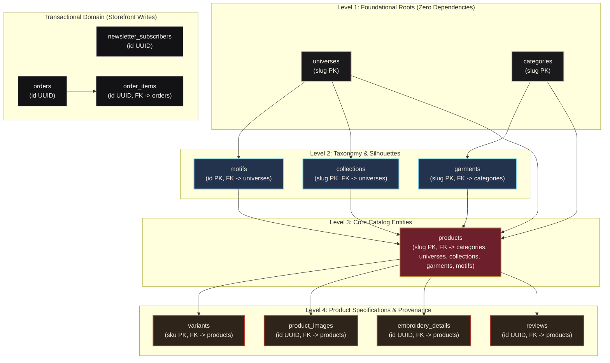

# UniqueLo — Production Database Management & Migration Guide

> **Official Operating Guide for Database Evolution, Schema Migrations, and Taxonomy Updates**  
> **Platform:** Supabase (Managed PostgreSQL 16 + Row Level Security + Storage CDN)  
> **Repository:** UniqueLo Haute Needlecraft Luxury E-Commerce

---

## 1. Core Principles & Philosophy

### 1.1 The Cardinal Rule: Never Wipe Production
```diff
- DROP TABLE IF EXISTS public.products CASCADE; -- NEVER RUN THIS IN PRODUCTION
```
Dropping tables destroys real customer orders, patron reviews, live newsletter signups, inventory stock counts, and artisan provenance.  
The `DROP TABLE ... CASCADE` block at the top of `supabase/schema.sql` is strictly for **fresh local development** or **sandbox rebuilds**. In production, all updates must be **additive, non-destructive, and backward-compatible**.

### 1.2 The Three Database Files & Their Specific Roles
| File | Role | Execution Timing | Data Contained |
| :--- | :--- | :--- | :--- |
| **`supabase/schema.sql`** | **Pure DDL Blueprint** | Once at initial project setup or disaster recovery | Tables, primary/foreign keys, check constraints, performance indexes, RLS policies, Storage buckets. **Zero catalog data rows.** |
| **`supabase/production-seed.sql`** | **Production Baseline Data** | Once right after initial `schema.sql` execution | Complete Master Taxonomy (3 Universes, 7 Motifs, 5 Categories, 9 Garments, 3 Collections) + exactly 2 authentic flagship products (`is_mock = false`). |
| **`supabase/seed.sql`** | **Local Development Data** | Localhost & demo testing | Master Taxonomy + 13 mock/legacy products. |
| **`supabase/migrations/`** | **Incremental Migrations** | Ongoing as new features/tables are released | Numbered SQL patches applied sequentially to evolving production databases. |

---

## 2. Relational Hierarchy & Foreign Key Dependencies

PostgreSQL enforces relational integrity through Foreign Key (FK) constraints. When inserting data or modifying tables, you **must respect the 4-level topological dependency order**:



### Why Queries Fail if Order is Violated:
- Inserting into `garments` with `category_slug = 'tops'` **fails** if `'tops'` has not already been inserted into `categories`.
- Inserting into `collections` with `universe_slug = 'animeverse'` **fails** if `'animeverse'` has not already been inserted into `universes`.
- Inserting a product referencing `garment_type = 'coat'` **fails** because the silhouette in `garments` is named `'jacket'`.

---

## 3. Workflow 1: Adding a New Table to Production

Follow this exact 6-step checklist whenever introducing a new database table (e.g., `lookbooks`, `artisan_profiles`, `coupons`).

### Step 1: Create a Migration File
Create a new file in `supabase/migrations/` using timestamped naming:
```
supabase/migrations/20261022_create_artisan_profiles.sql
```

### Step 2: Write Safe, Idempotent DDL
Always use `CREATE TABLE IF NOT EXISTS`, define foreign keys with appropriate `ON DELETE` rules, and set defaults:

```sql
-- supabase/migrations/20261022_create_artisan_profiles.sql
-- Description: Stores artisan guild profiles and workshop master details.

CREATE TABLE IF NOT EXISTS public.artisan_profiles (
  slug text PRIMARY KEY,
  name text NOT NULL,
  guild_name text NOT NULL,
  region text NOT NULL,
  experience_years integer NOT NULL DEFAULT 10,
  specialty text NOT NULL,
  biography text NOT NULL,
  portrait_src text,
  is_active boolean DEFAULT true,
  created_at timestamptz DEFAULT timezone('utc'::text, now()) NOT NULL
);

-- Indexes for fast query lookup
CREATE INDEX IF NOT EXISTS idx_artisan_profiles_region ON public.artisan_profiles(region);
```

### Step 3: Configure Row Level Security (RLS) — MANDATORY
> [!IMPORTANT]
> In Supabase, as soon as you enable RLS on a table, **all queries return 0 rows** until you explicitly add a `POLICY`. You must define both public read and admin write policies:

```sql
-- 1. Enable RLS
ALTER TABLE public.artisan_profiles ENABLE ROW LEVEL SECURITY;

-- 2. Public Read Policy (Allow storefront visitors to view active artisans)
CREATE POLICY "Allow public read artisan profiles" 
  ON public.artisan_profiles 
  FOR SELECT 
  USING (is_active = true);

-- 3. Admin Studio Write Policies (Allow admin client to create/edit/delete)
CREATE POLICY "Allow admin insert artisan profiles" 
  ON public.artisan_profiles 
  FOR INSERT 
  WITH CHECK (true);

CREATE POLICY "Allow admin update artisan profiles" 
  ON public.artisan_profiles 
  FOR UPDATE 
  USING (true);

CREATE POLICY "Allow admin delete artisan profiles" 
  ON public.artisan_profiles 
  FOR DELETE 
  USING (true);
```

### Step 4: Update `supabase/schema.sql`
Add the table definition and its policies into [supabase/schema.sql](file:///Users/apple/MySpace/UniqueLo/supabase/schema.sql) so that any future fresh deployment (or staging environment) automatically includes this table.

### Step 5: Update TypeScript Types & Data Adapter
Update [src/lib/data.ts](file:///Users/apple/MySpace/UniqueLo/src/lib/data.ts) with the matching TypeScript interface and fetching function:
```typescript
export interface ArtisanProfile {
  slug: string;
  name: string;
  guildName: string;
  region: string;
  experienceYears: number;
  specialty: string;
  biography: string;
  portraitSrc?: string;
}

export async function getArtisanProfiles(): Promise<ArtisanProfile[]> {
  if (isSupabaseConfigured() && supabase) {
    const { data, error } = await supabase
      .from('artisan_profiles')
      .select('*')
      .eq('is_active', true);
    if (!error && data) {
      return data.map((a: any) => ({
        slug: a.slug,
        name: a.name,
        guildName: a.guild_name,
        region: a.region,
        experienceYears: a.experience_years,
        specialty: a.specialty,
        biography: a.biography,
        portraitSrc: a.portrait_src,
      }));
    }
  }
  return []; // Fallback
}
```

### Step 6: Apply to Supabase Production
1. Open the [Supabase Dashboard](https://supabase.com/dashboard) → Select your Production Project.
2. Navigate to **SQL Editor** → Click **New Query**.
3. Paste the contents of your migration script wrapped in a transaction:
   ```sql
   BEGIN;
   -- Paste migration script here
   COMMIT;
   ```
4. Click **Run**. Verify the green success toast.

---

## 4. Workflow 2: Adding a New Column or Constraint to an Existing Table

When adding fields (e.g., adding `sustainability_score` to `products` or `is_featured` to `categories`), follow these zero-downtime rules:

### Safe Column Addition Rules:
1. **Always use `IF NOT EXISTS`**: Prevents errors if the migration is executed more than once.
2. **Never add `NOT NULL` without a `DEFAULT`**: Adding `NOT NULL` without a default value will fail immediately on tables containing existing rows.
3. **Safe Foreign Key additions**: Add the constraint with `ON DELETE SET NULL` so deleting a parent row doesn't break products.

### Example Migration Script:
```sql
-- supabase/migrations/20261023_add_product_sustainability.sql

-- 1. Add column with a safe default value
ALTER TABLE public.products
  ADD COLUMN IF NOT EXISTS sustainability_score smallint DEFAULT 5 CHECK (sustainability_score BETWEEN 1 AND 5),
  ADD COLUMN IF NOT EXISTS eco_certifications text[] DEFAULT '{}';

-- 2. Optional: Index the new column if it will be used for filtering
CREATE INDEX IF NOT EXISTS idx_products_sustainability ON public.products(sustainability_score);
```

### Synchronize Application Layer:
1. Update `supabase/schema.sql` in the corresponding table definition.
2. In [src/lib/data.ts](file:///Users/apple/MySpace/UniqueLo/src/lib/data.ts):
   - Add the new field to the `Product` interface: `sustainabilityScore?: number; ecoCertifications?: string[];`.
   - Update `getProducts()` Supabase `.select(...)` query to include the new columns.
   - Map with a fallback default: `sustainabilityScore: item.sustainability_score ?? 5,`.
   - Update `src/data/mock-products.json` fallback seed so local development has matching data.

---

## 5. Workflow 3: Adding or Updating Taxonomy Data (Universes, Motifs, Categories, Garments, Collections)

When the business introduces a new Category (e.g., `'footwear'`), a new Garment silhouette (e.g., `'kimono'`), or a new Collection capsule, use **idempotent upserts** (`ON CONFLICT DO UPDATE`).

### 5.1 Adding a New Category
```sql
INSERT INTO public.categories (slug, name, label, description, image, order_num)
VALUES (
  'kimonos',
  'Kimonos & Haori',
  'Kimonos',
  'Structured artisanal haori jackets and floor-length silk kimono overcoats.',
  '/images/categories/outerwear.jpg',
  6
)
ON CONFLICT (slug) DO UPDATE SET
  name = EXCLUDED.name,
  label = EXCLUDED.label,
  description = EXCLUDED.description,
  order_num = EXCLUDED.order_num;
```

### 5.2 Adding a New Garment Silhouette
> [!IMPORTANT]
> The `category_slug` MUST already exist in `public.categories`.

```sql
INSERT INTO public.garments (slug, name, category_slug, description, order_num)
VALUES (
  'haori',
  'Haori Jackets',
  'kimonos', -- References categories.slug
  'Traditional wide-sleeve kimono jackets carrying bold back-panel needlework.',
  10
)
ON CONFLICT (slug) DO UPDATE SET
  name = EXCLUDED.name,
  category_slug = EXCLUDED.category_slug,
  description = EXCLUDED.description,
  order_num = EXCLUDED.order_num;
```

### 5.3 Adding a New Thematic Drop / Collection
> [!NOTE]
> If the collection belongs to a universe, specify its `universe_slug` (`'animeverse'`, `'heroverse'`, or `'itihaas'`). If universe-neutral, set to `NULL`.

```sql
INSERT INTO public.collections (slug, name, tagline, description, universe_slug, featured, order_num)
VALUES (
  'samurai-twilight',
  'Samurai Twilight Collection',
  'Indigo shadows, katana arcs, and silver bullion embroidery.',
  'Night-toned apparel inspired by classic ronin epics with dense silver bullion threadwork.',
  'animeverse', -- References universes.slug (or NULL for universe-neutral)
  true,
  4
)
ON CONFLICT (slug) DO UPDATE SET
  name = EXCLUDED.name,
  tagline = EXCLUDED.tagline,
  description = EXCLUDED.description,
  universe_slug = EXCLUDED.universe_slug,
  featured = EXCLUDED.featured,
  order_num = EXCLUDED.order_num;
```

### 5.4 Keeping Local JSON in Sync
Whenever new taxonomy rows are added to the production database:
1. Add the matching JSON record in `src/data/categories.json`, `src/data/garments.json`, `src/data/collections.json`, or `src/data/motifs.json`.
2. Add the record into [supabase/production-seed.sql](file:///Users/apple/MySpace/UniqueLo/supabase/production-seed.sql) to maintain parity for fresh deploys.

---

## 6. Workflow 4: Adding New Products to Production

There are two primary ways to add new products to production:

### Method A (Recommended): In-App Admin Studio (`/admin`)
No SQL writing is required. Use the built-in Admin Studio:
1. Open UniqueLo in your browser and visit `/admin`.
2. **Metadata & Classification:** Fill product title, story, price in INR, and select Universe, Category, Silhouette, and Collection from the validated dropdowns.
3. **Photography CDN Upload:** Drag and drop high-resolution JPG/PNG images into the 6 spec slots. The Admin Studio automatically uploads them to the `product-images` Supabase Storage bucket and generates public CDN URLs.
4. **Artisan Provenance:** Specify embroidery technique, stitch count, artisan hours, and placement.
5. **Publish:** Click **Generate SQL** to copy the transaction, or click **Publish to Supabase** to insert directly via the authenticated client.

### Method B: SQL Insertion Script
If inserting via the Supabase SQL Editor, execute in this strict order within a single transaction:

```sql
BEGIN;

-- 1. Base Product Record
INSERT INTO public.products (
  slug, name, subtitle, foreign_tagline, description, category_slug, universe_slug,
  collection_slug, garment_type, gender, motif_id, is_mock, handcrafted, intensity,
  craft_techniques, edits, expression_score, expression_slug, vibes, moods,
  rating, review_count, sold_count, tags, featured, customizable,
  material, care, fit, batch_number, batch_total, craft_region, craft_cluster, fabric_gsm
) VALUES (
  'monochrome-katana-hoodie',
  'Monochrome Katana Oversized Hoodie',
  '450 GSM organic loopback fleece with high-relief silver blade embroidery',
  '単色刀',
  'Artisanal heavyweight hoodie featuring an angled katana blade and cherry blossom petals embroidered in monochrome silk-poly across the full back yoke.',
  'tops',            -- Must exist in categories
  'animeverse',      -- Must exist in universes
  'spring-sakura',   -- Must exist in collections (or NULL)
  'hoodie',          -- Must exist in garments
  'unisex',
  'sakura',          -- Must exist in motifs (or NULL)
  false,             -- Production live item
  true,              -- Handcrafted atelier piece
  'balanced',        -- 'quiet' | 'balanced' | 'loud'
  ARRAY['high-relief-fill', 'satin-stitch'],
  ARRAY['statement', 'everyday'],
  3,
  'cult',            -- 'minimal' | 'understated' | 'cult' | 'expressive' | 'maximalist'
  ARRAY['aesthetic', 'noir'],
  ARRAY['statement', 'poetic'],
  5.0, 14, '65+',
  ARRAY['hoodie', 'katana', 'animeverse', 'black', 'heavyweight'],
  true, false,
  ARRAY['100% GOTS Organic Cotton Fleece (450 GSM)', 'Japanese Rayon Threads'],
  ARRAY['Machine wash cold gentle', 'Dry flat in shade'],
  'Boxy oversized atelier drape',
  1, 50,
  'Kyoto & Tirupur Guild', 'Master Needlecraft Studio', '450 GSM'
) ON CONFLICT (slug) DO UPDATE SET
  name = EXCLUDED.name,
  subtitle = EXCLUDED.subtitle,
  description = EXCLUDED.description;

-- 2. Images (Slots 0 to 5)
DELETE FROM public.product_images WHERE product_slug = 'monochrome-katana-hoodie';
INSERT INTO public.product_images (product_slug, src, alt, color, sort_order) VALUES
  ('monochrome-katana-hoodie', '/images/products/sakura-ronin-hoodie-1.jpg', 'Monochrome Katana Hoodie — front', '#111113', 0),
  ('monochrome-katana-hoodie', '/images/products/sakura-ronin-hoodie-2.jpg', 'Monochrome Katana Hoodie — back embroidery', '#111113', 1);

-- 3. Variants (Sizes & Inventory)
DELETE FROM public.variants WHERE product_slug = 'monochrome-katana-hoodie';
INSERT INTO public.variants (sku, product_slug, color, color_hex, size, price_cents, compare_at_price_cents, status, quantity) VALUES
  ('MKH-BLK-S', 'monochrome-katana-hoodie', 'Nocturne Black', '#111113', 'S', 949000, 1150000, 'in-stock', 15),
  ('MKH-BLK-M', 'monochrome-katana-hoodie', 'Nocturne Black', '#111113', 'M', 949000, 1150000, 'in-stock', 20),
  ('MKH-BLK-L', 'monochrome-katana-hoodie', 'Nocturne Black', '#111113', 'L', 949000, 1150000, 'in-stock', 15),
  ('MKH-BLK-XL', 'monochrome-katana-hoodie', 'Nocturne Black', '#111113', 'XL', 949000, 1150000, 'low-stock', 4);

-- 4. Embroidery Specifications
DELETE FROM public.embroidery_details WHERE product_slug = 'monochrome-katana-hoodie';
INSERT INTO public.embroidery_details (
  product_slug, technique, technique_label, artisan_hours, placement, thread_composition, motif_story
) VALUES (
  'monochrome-katana-hoodie',
  'high-density-fill',
  'High-Density Relief Stitching',
  16,
  ARRAY['Center Back Full Yoke', 'Left Cuff Katana Monogram'],
  '100% Japanese Rayon & Metallic Silver Thread',
  'Continuous needle paths tracing a solitary katana blade cutting through falling blossom petals.'
);

COMMIT;
```

---

## 7. Production Deployment & Verification Runbook

### Pre-Migration Checklist:
- [ ] Migration script authored in `supabase/migrations/` with idempotent syntax (`IF NOT EXISTS`, `ON CONFLICT DO UPDATE`).
- [ ] All Foreign Key values verified against parent tables (`universes`, `categories`, `garments`, `motifs`).
- [ ] Row Level Security (RLS) policies included for both public SELECT and admin INSERT/UPDATE/DELETE.
- [ ] Tested locally with `npm run build` to verify zero TypeScript errors.

### Execution in Production:
1. Open Supabase Dashboard → Project → **SQL Editor**.
2. Run your migration query wrapped in `BEGIN; ... COMMIT;`.
3. Check the Execution Output: `Success. No rows returned` or rows affected.

### Post-Migration Verification Queries:
Run these diagnostic queries in Supabase SQL Editor to verify health:

```sql
-- 1. Check Row Counts across all catalog tables
SELECT 'universes' as table_name, count(*) as count FROM public.universes
UNION ALL
SELECT 'motifs', count(*) FROM public.motifs
UNION ALL
SELECT 'categories', count(*) FROM public.categories
UNION ALL
SELECT 'garments', count(*) FROM public.garments
UNION ALL
SELECT 'collections', count(*) FROM public.collections
UNION ALL
SELECT 'products', count(*) FROM public.products
UNION ALL
SELECT 'variants', count(*) FROM public.variants
UNION ALL
SELECT 'product_images', count(*) FROM public.product_images
UNION ALL
SELECT 'embroidery_details', count(*) FROM public.embroidery_details;

-- 2. Verify Relational Integrity (Must return 0 orphan rows)
SELECT p.slug, p.name 
FROM public.products p
LEFT JOIN public.categories c ON p.category_slug = c.slug
WHERE p.category_slug IS NOT NULL AND c.slug IS NULL;

-- 3. Verify RLS Policies are enabled and configured
SELECT tablename, rowsecurity 
FROM pg_tables 
WHERE schemaname = 'public';
```

---

## 8. Admin Studio (`/admin`) Database Mapping Matrix & Taxonomy Engine

The in-app Admin Studio (`/admin`) connects directly to the Supabase PostgreSQL database. Every dropdown and input field is badged with the exact database table and column responsible for storing that value.

### 8.1 Dropdown Database Mapping Reference

| Admin Dropdown | Target Database Table | Column / Key | Dynamic Data Source | Constraints / FK Dependency |
| :--- | :--- | :--- | :--- | :--- |
| **Category** | `public.categories` | `slug (PK)` | `useCategories()` from `public.categories` | Roots Level 1. Parent of `garments` and `products`. |
| **Universe (World)** | `public.universes` | `slug (PK)` | `useUniverses()` from `public.universes` | Roots Level 1. Parent of `motifs`, `collections`, and `products`. |
| **Gender Facet** | `public.products` | `gender` | Hardcoded Facets | `CHECK (gender IN ('men', 'women', 'unisex'))`. |
| **Collection (Drop)** | `public.collections` | `slug (PK)` | `useCollections()` from `public.collections` | Level 2 entity. Optional FK `universe_slug -> public.universes(slug)`. |
| **Garment Silhouette**| `public.garments` | `slug (PK)` | `useGarments()` from `public.garments` | Level 2 entity. Mandatory FK `category_slug -> public.categories(slug)`. Auto-syncs parent category. |
| **Lore Motif** | `public.motifs` | `id (PK)` | `useMotifsByUniverse(universeSlug)` | Level 2 entity. Mandatory FK `universe_slug -> public.universes(slug)`. |
| **Craft Technique** | `public.embroidery_details` | `technique` | Supported Heritage Needlecrafts | Text slug matching Indian & Eastern heritage needlecraft methods. |
| **Variant Status** | `public.variants` | `status` | Stock Inventory State | `CHECK (status IN ('in-stock', 'low-stock', 'out-of-stock'))`. |

### 8.2 Form Field & Card Mapping

| Admin Section | Field Name | Target Table | Target Column / Type | Description / Notes |
| :--- | :--- | :--- | :--- | :--- |
| **Core Product Identity** | Product Title | `public.products` | `name text` | Display name of the luxury piece. |
| | Product Slug | `public.products` | `slug text PRIMARY KEY` | URL identifier for `/products/:slug`. |
| | Foreign Tagline | `public.products` | `foreign_tagline text` | Devanagari or Kanji script subtitle. |
| | Editorial Subtitle | `public.products` | `subtitle text` | Highlighting craft provenance or textile spec. |
| | Narrative Story | `public.products` | `description text` | Full atelier product description. |
| | Curated Edits | `public.products` | `edits text[]` | Array of gateway tags (e.g. `['everyday', 'heritage']`). |
| | Style Level | `public.products` | `expression_score smallint`, `expression_slug text` | Signature 1–5 discovery axis (`minimal`, `understated`, `cult`, `expressive`, `maximalist`). |
| | Search Tags | `public.products` | `tags text[]` | Array of keyword tags for search index. |
| | Status Toggles | `public.products` | `featured boolean`, `customizable boolean`, `handcrafted boolean` | Booleans controlling storefront banners and studio customizer. |
| **Embroidery Provenance** | Craft Technique | `public.embroidery_details` | `technique text` | Needlecraft method (e.g., `'aari'`, `'zardozi'`, `'sashiko'`). |
| | Artisan Hours | `public.embroidery_details` | `artisan_hours integer` | Total manual workshop hours invested in stitching. |
| | Display Label | `public.embroidery_details` | `technique_label text` | Formatted label (e.g., `'Royal Court Zardozi'`). |
| | Thread Composition | `public.embroidery_details` | `thread_composition text` | Materials used in needlework (e.g., `'Metallic Gold Wire & Mulberry Silk'`). |
| | Placement | `public.embroidery_details` | `placement text[]` | Anatomical garment embroidery zones (`['Center Back Yoke', 'Left Cuff']`). |
| | Motif Lore Story | `public.embroidery_details` | `motif_story text` | Narrative lore explaining the heraldry or symbol. |
| **Textile & Atelier Batch** | Regional Cluster | `public.products` | `craft_region text` | Geographic craft origin (e.g., `'Kashmir Valley'`, `'Varanasi'`). |
| | Craft Guild | `public.products` | `craft_cluster text` | Guild or workshop name (e.g., `'Zardozi Guild of Old Delhi'`). |
| | Fabric GSM | `public.products` | `fabric_gsm text` | Fabric weight specification (e.g., `'450 GSM Loopback Fleece'`). |
| | Batch Number / Total | `public.products` | `batch_number integer`, `batch_total integer` | Limited edition run numbering (e.g., Batch `1` of `50`). |
| | Primary Materials | `public.products` | `material text[]` | Array of raw textile fabrics (`['100% Organic Cotton', 'Mulberry Silk']`). |
| | Care Instructions | `public.products` | `care text[]` | Preservation and laundry guide. |
| | Silhouette Fit | `public.products` | `fit text` | Fit description (e.g., `'Boxy Oversized Atelier Cut'`). |
| **Variant Matrix** | SKU | `public.variants` | `sku text PRIMARY KEY` | Stock keeping unit (e.g., `'RONIN-HOODIE-BLK-M'`). |
| | Color / Hex | `public.variants` | `color text`, `color_hex text` | Color name and hex color code. |
| | Size | `public.variants` | `size text` | Garment sizing code (`'XS'`, `'S'`, `'M'`, `'L'`, `'XL'`, `'XXL'`). |
| | Price in Cents | `public.variants` | `price_cents integer` | Currency value stored in integer cents (e.g. `38000` = ₹380.00). |
| | Quantity | `public.variants` | `quantity integer` | Live physical stock count. |
| **Visual Deck** | Image CDN URLs | `public.product_images` + `storage.objects` | `src text`, `alt text`, `sort_order integer` | High-res imagery uploaded to `product-images` storage bucket. |

### 8.3 In-App Dynamic Taxonomy Engine

You no longer need to write SQL queries to create new categories, silhouettes, or collections. The Admin Studio provides inline modal creators:
1. **`+ New Category`**:
   - Opens an inline modal right above the Category dropdown.
   - Fields: Name, Slug, Short Label, Description.
   - Saves to `public.categories` via `supabase.from('categories').upsert(...)`.
   - Automatically invalidates React Query cache (`catalogKeys.categories`).
   - Immediately becomes selected in the form and active in `/category/:slug` discovery doors.
   - Includes a **📋 Copy SQL** button for auditing.
2. **`+ New Garment`**:
   - Opens an inline modal right above the Garment Silhouette dropdown.
   - Fields: Silhouette Name, Slug, Parent Category (from `public.categories`), Description.
   - Saves to `public.garments` via `supabase.from('garments').upsert(...)`.
   - Automatically invalidates `catalogKeys.garments`.
   - Links to `/clothing/:slug` and auto-syncs the parent category.
3. **`+ New Collection`**:
   - Opens an inline modal right above the Collection dropdown.
   - Fields: Collection Title, Slug, Tagline, Universe linkage (from `public.universes`), Description.
   - Saves to `public.collections` via `supabase.from('collections').upsert(...)`.
   - Automatically invalidates `catalogKeys.collections`.
   - Links to `/collections/:slug`.

